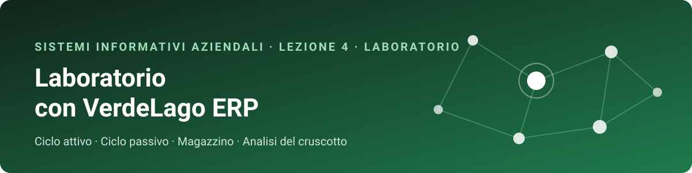
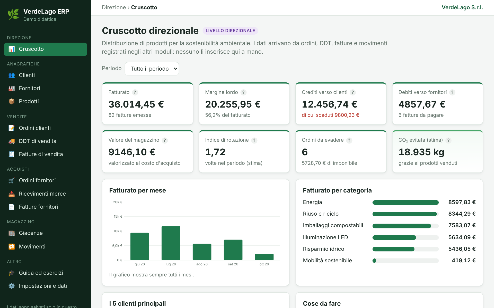

**VerdeLago ERP** è un piccolo gestionale integrato (ERP) per le esercitazioni di **Sistemi Informativi Aziendali** (Informatica, 4ª AFM). Funziona direttamente nel browser, senza installare nulla.

## ▶ [Apri VerdeLago ERP](https://pg-laboratorio.github.io/verdelago-erp/)

## 📋 [Scheda di laboratorio](laboratorio.md)

La scheda guida passo passo l'esercitazione:
- ciclo attivo, dal nuovo cliente all'incasso;
- merce insufficiente;
- ciclo passivo con il riordino;
- analisi del cruscotto;
- consegna del lavoro.

In fondo trovi la **scheda delle risposte** da compilare.

---

## L'azienda

**VerdeLago S.r.l.** è un'azienda (di fantasia) di Desenzano del Garda che distribuisce prodotti per la **sostenibilità ambientale**: imballaggi compostabili, riduttori di flusso, lampadine LED, pannelli solari portatili, compostiere. I suoi clienti sono hotel, ristoranti, campeggi, negozi e uffici. All'apertura il programma contiene già cinque mesi di attività (giugno–ottobre 2026).



| Modulo | Che cosa si fa | Livello |
|---|---|---|
| 👥 Anagrafiche | Clienti, fornitori, prodotti | operativo |
| 📝 Vendite | Ordine cliente → DDT → fattura → incasso | operativo |
| 🛒 Acquisti | Ordine fornitore → ricevimento merce → fattura passiva → pagamento | operativo |
| 🏬 Magazzino | Giacenze, merce impegnata e in arrivo, scorte minime, riordino, rettifiche | operativo |
| 📊 Cruscotto | Fatturato, margine, crediti e debiti, rotazione del magazzino, CO₂ evitata | direzionale |

Dentro il programma, la pagina **Guida ed esercizi** contiene altre attività da svolgere in autonomia.

> [!NOTE]
> I dati restano salvati **solo nel browser** che stai usando. Prima di chiudere, usa *Impostazioni e dati → Esporta dati* per conservare il tuo lavoro o consegnarlo al docente. Con *Ripristina dati demo* torni alla situazione iniziale.

---

<details>
<summary><strong>Per il docente: come pubblicare il repository</strong></summary>

1. Crea su GitHub un repository **pubblico** chiamato `verdelago-erp` e carica tutto il contenuto di questa cartella, compreso il file nascosto `.nojekyll`.
2. In **Settings → Pages** scegli *Deploy from a branch*, branch **main**, cartella **/ (root)**, e salva.
3. Dopo un paio di minuti il programma è raggiungibile all'indirizzo `https://<utente>.github.io/verdelago-erp/`.
4. In questo README e in `laboratorio.md` sostituisci `pg-laboratorio` con il tuo nome utente GitHub.

**Struttura**

```
index.html, css/, js/   il programma VerdeLago ERP
laboratorio.md          la scheda dell'esercitazione
img/                    screenshot e immagini della scheda
```

**Semplificazioni didattiche:** il programma non gestisce consegne parziali, note di credito, più magazzini, più utenti contemporanei né la contabilità; gli aspetti fiscali si limitano al calcolo dell'IVA. Per cambiare i dati dell'azienda di esempio si modifica `js/demo-data.js` e poi si usa *Ripristina dati demo*.

</details>

---

<sub>Tutti i nomi di aziende, persone, partite IVA e dati sono di fantasia. I valori di CO₂ evitata sono indicativi.</sub>
