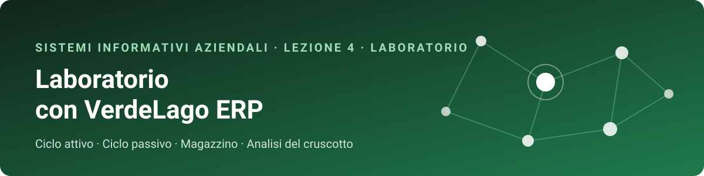
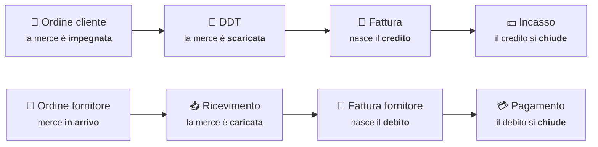
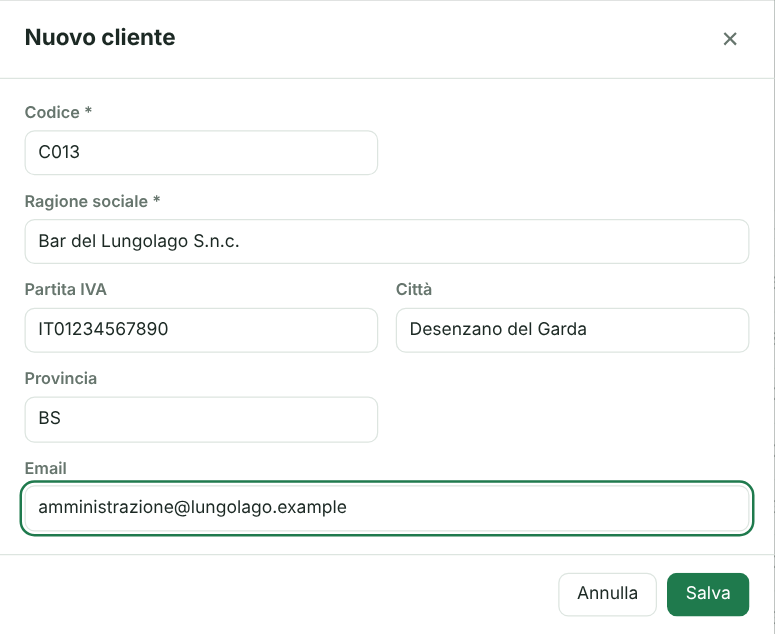
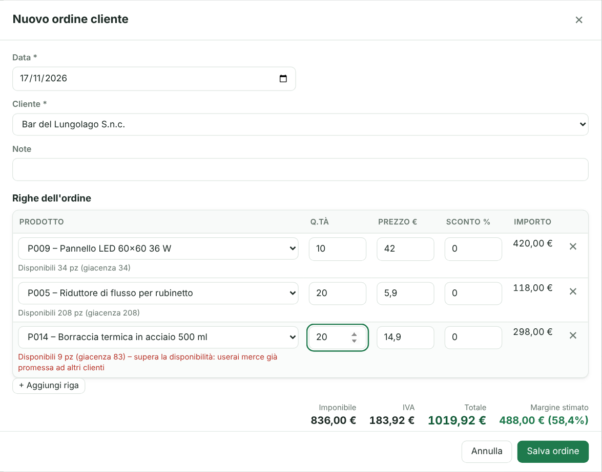
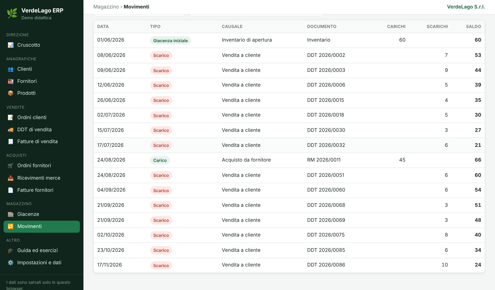
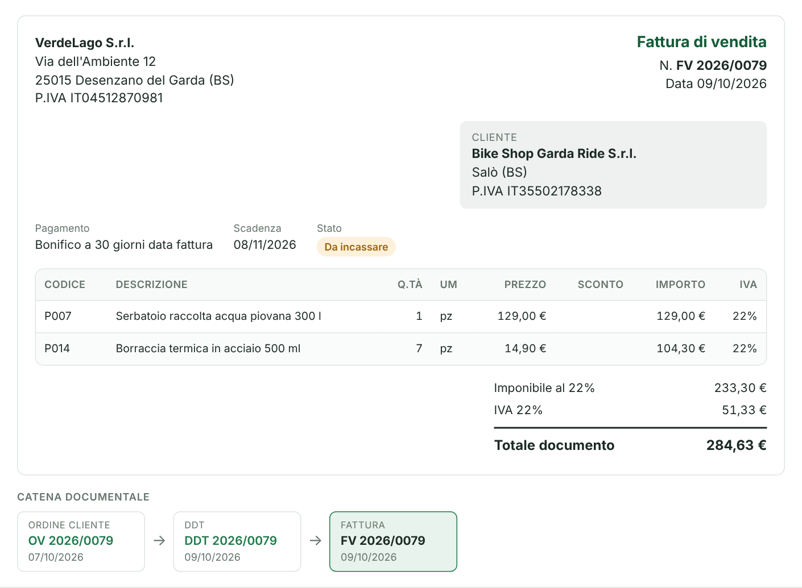
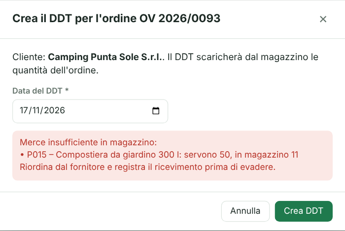
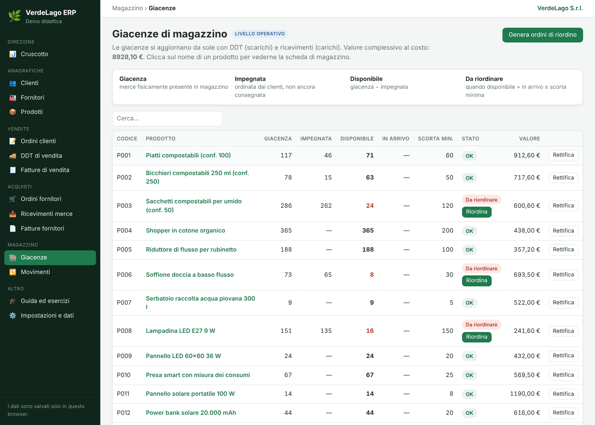
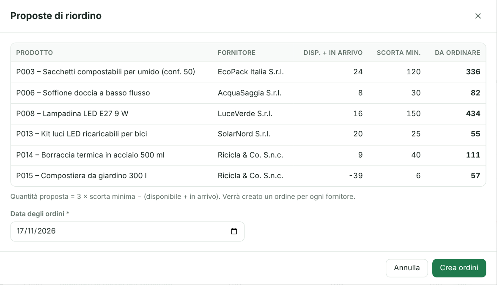
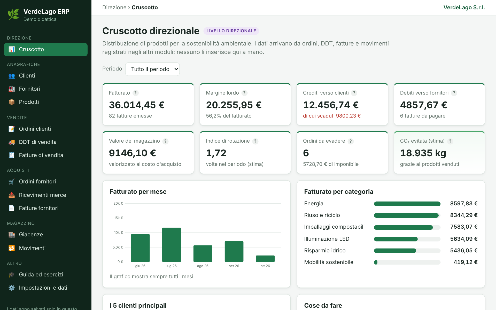

[⬅ Torna a VerdeLago ERP](README.md) · **▶ [Apri il programma](https://TUO-UTENTE.github.io/verdelago-erp/)**

> [!NOTE]
> **In questo laboratorio:**
> - percorrerai il **ciclo attivo** (vendite) e il **ciclo passivo** (acquisti) dentro un ERP;
> - vedrai come un'operazione registrata in un modulo **aggiorna automaticamente** gli altri;
> - passerai dal **livello operativo** al **livello direzionale**, leggendo il cruscotto;
> - consegnerai il tuo lavoro esportando i dati e compilando la **scheda delle risposte**.
>
> ⏱️ **Durata:** 2 ore · 💻 **Serve:** un PC con un browser aggiornato (Chrome, Edge o Firefox)

---

## Prima di iniziare

1. Apri **VerdeLago ERP** dal link che ti ha dato il docente (lo trovi anche in cima a questa pagina).
2. Vai in **Impostazioni e dati** e premi **↺ Ripristina dati demo**, così parti dalla stessa situazione dei compagni.
3. Tieni aperta in un'altra scheda questa pagina, oppure stampa la [scheda delle risposte](#-scheda-delle-risposte) in fondo.

> [!WARNING]
> I dati restano salvati **solo in questo browser, su questo PC**. Se cambi computer o cancelli la cronologia li perdi. Alla fine del laboratorio dovrai **esportarli** (Parte F).

### La mappa del laboratorio

| Parte | Attività | Tempo |
|:-:|---|:-:|
| **A** | Esplorare l'azienda e il programma | 15' |
| **B** | Ciclo attivo: dal nuovo cliente all'incasso | 30' |
| **C** | Il caso della merce insufficiente | 15' |
| **D** | Ciclo passivo: riordino e acquisti | 25' |
| **E** | Analisi direzionale con il cruscotto | 25' |
| **F** | Esportazione e consegna | 10' |

---

## Parte A – Esplorare l'azienda (15')

Prima di lavorare, guardati intorno. Usa il menu a sinistra e rispondi alle domande **A1–A5** della scheda.

- In **Anagrafiche → Clienti**: quanti clienti ha VerdeLago? In quali province si trovano soprattutto?
- In **Anagrafiche → Prodotti**: quale prodotto ha il prezzo di vendita più alto? Quale ha il **margine percentuale** più alto?
- In **Anagrafiche → Fornitori**: chi fornisce le lampadine LED?
- Osserva le etichette accanto ai titoli delle pagine: quali pagine sono di **livello operativo** e quale di **livello direzionale**?

> [!TIP]
> Ogni elenco ha una casella **Cerca…**: scrivi una parola (ad esempio *LED*) per filtrare le righe.

---

## Parte B – Ciclo attivo: dal nuovo cliente all'incasso (30')

### B1. Inserisci un nuovo cliente

Vai in **Anagrafiche → Clienti** e premi **+ Nuovo cliente**. Il codice viene proposto automaticamente. Inserisci:

| Campo | Valore |
|---|---|
| Ragione sociale | **Bar del Lungolago S.n.c.** |
| Città / Provincia | **Desenzano del Garda** / **BS** |
| Partita IVA | **IT01234567890** |
| Email | **amministrazione@lungolago.example** |

### B2. Crea l'ordine del cliente

Il bar vuole rinnovare l'illuminazione e ridurre i consumi d'acqua. Vai in **Vendite → Ordini clienti → + Nuovo ordine**, scegli il cliente appena creato e inserisci due righe:

| Prodotto | Quantità |
|---|:-:|
| P009 – Pannello LED 60×60 36 W | **10** |
| P005 – Riduttore di flusso per rubinetto | **20** |

Il **prezzo** si compila da solo con il prezzo di listino. In basso vedi imponibile, IVA, totale e il **margine stimato**.

**Ora un esperimento.** Aggiungi una terza riga: *P014 – Borraccia termica*, quantità **20**. Leggi il messaggio che compare sotto la riga.

> [!IMPORTANT]
> **Giacenza ≠ disponibilità.** In magazzino ci sono molte borracce (**giacenza**), ma quasi tutte sono già promesse ad altri clienti con ordini non ancora consegnati (merce **impegnata**). La **disponibilità** è ciò che resta: *giacenza − impegnato*. Vendere merce già promessa significa lasciare a mani vuote un altro cliente.

Rimuovi la riga delle borracce con la ✕ e premi **Salva ordine** (domande **B1–B2** della scheda).

### B3. Evadi l'ordine con il DDT

Nella finestra dell'ordine premi **Crea DDT** e conferma la data. Il DDT accompagna la merce dal cliente e **scarica il magazzino**.

Vai in **Magazzino → Giacenze** e **clicca sul nome del pannello LED**: si apre la sua **scheda di magazzino**. Trovi il movimento di scarico con il numero del tuo DDT? Qual è il saldo finale? (domanda **B3**)

### B4. Emetti la fattura

Vai in **Vendite → DDT di vendita**, trova il tuo DDT (è il primo dell'elenco) e premi **Crea fattura**. Osserva la fattura:

- l'**IVA** è calcolata al 22% sull'imponibile;
- la **scadenza** è a 30 giorni dalla data della fattura;
- in basso la **catena documentale** mostra ordine → DDT → fattura: puoi cliccare su ciascun documento.

Ora apri il **Cruscotto**. Come sono cambiati *Fatturato* e *Crediti verso clienti*? (domanda **B4**)

### B5. Registra l'incasso

Il bar paga con un bonifico. In **Vendite → Fatture di vendita** premi **Incassa** sulla tua fattura e conferma. Il credito si chiude: controlla di nuovo il cruscotto.

---

## Parte C – Il caso della merce insufficiente (15')

Un camping vuole regalare una compostiera a ogni piazzola. Crea un nuovo ordine per **Camping Punta Sole S.r.l.** con **50** pezzi di *P015 – Compostiera da giardino 300 l*. Salva e prova a creare il DDT.

Il programma **blocca** l'operazione. Rispondi alle domande **C1–C2**:

- Perché l'ERP non permette di emettere il DDT?
- Che cosa dovrebbe fare l'ufficio acquisti per poter evadere l'ordine?

> [!TIP]
> Questo è un **controllo di integrità**: il sistema impedisce di registrare un'operazione impossibile nella realtà (consegnare merce che non c'è). In un sistema con archivi separati nessuno se ne accorgerebbe fino al momento di caricare il furgone.

Lascia l'ordine aperto: lo potrai evadere dopo il riordino, se vuoi.

---

## Parte D – Ciclo passivo: riordino e acquisti (25')

### D1. Le proposte di riordino

Vai in **Magazzino → Giacenze**. Alcuni prodotti hanno lo stato **Da riordinare** (in rosso): la loro disponibilità più la merce in arrivo è scesa sotto la **scorta minima**.

Premi **Genera ordini di riordino**. L'ERP propone una quantità per ogni prodotto e crea **un ordine per ogni fornitore**.

Quanti ordini sono stati creati? A quali fornitori? (domanda **D1**)

### D2. Ricevimento, fattura e pagamento

Per **uno** degli ordini appena creati, in **Acquisti → Ordini fornitori**:

1. premi **Registra ricevimento**: la merce viene **caricata** in magazzino;
2. dalla finestra del ricevimento premi **Registra fattura** e inserisci un numero di fattura del fornitore (ad esempio *FT 245/2026*);
3. in **Acquisti → Fatture fornitori** premi **Paga** per chiudere il debito.

Torna in **Magazzino → Giacenze**: lo stato del prodotto è cambiato? (domanda **D2**)

### D3. (facoltativo) Rettifica inventariale

Durante il conteggio fisico trovi **2 soffioni doccia in meno** di quelli registrati. In **Giacenze** premi **Rettifica** sulla riga del soffione e inserisci la quantità contata. Controlla il movimento nella scheda di magazzino.

---

## Parte E – Analisi direzionale (25')

Ora sei la **direzione** di VerdeLago. Apri il **Cruscotto** e usa il filtro **Periodo** in alto a destra. Rispondi alle domande **E1–E6** della scheda, motivando ogni risposta con i dati.

- **E1.** In quale mese VerdeLago ha fatturato di più? Che cosa potrebbe spiegare l'andamento da giugno a ottobre? *(Suggerimento: chi sono i clienti dell'azienda? In agosto c'è una chiusura estiva.)*
- **E2.** Quale categoria di prodotti porta più fatturato? Quale meno?
- **E3.** Chi è il cliente più importante?
- **E4.** Ci sono fatture scadute non incassate? Per quale importo? Che cosa dovrebbe fare l'amministrazione?
- **E5.** Leggi la formula del margine lordo (punto di domanda accanto all'indicatore). Spiegala con parole tue.
- **E6.** Scrivi **tre consigli** alla direzione basati su ciò che hai visto.

---

## Parte F – Esportazione e consegna (10')

1. Vai in **Impostazioni e dati** e premi **⬇ Esporta dati (file JSON)**.
2. Rinomina il file con il tuo cognome, ad esempio `rossi-verdelago.json`.
3. Consegna il file e la scheda delle risposte come indicato dal docente (ad esempio su Classroom).

> [!NOTE]
> Il file JSON contiene **tutto il database** della tua azienda: anagrafiche, documenti e movimenti. Il docente può importarlo nel proprio browser e vedere esattamente ciò che hai registrato.

---

## 📋 Scheda delle risposte

*Nome e cognome: ______________________ Classe: ______ Data: ____________*

| # | Domanda | Risposta&nbsp;&nbsp;&nbsp;&nbsp;&nbsp;&nbsp;&nbsp;&nbsp;&nbsp;&nbsp;&nbsp;&nbsp;&nbsp;&nbsp;&nbsp;&nbsp;&nbsp;&nbsp;&nbsp;&nbsp;&nbsp;&nbsp;&nbsp;&nbsp;&nbsp;&nbsp;&nbsp;&nbsp;&nbsp;&nbsp;&nbsp;&nbsp;&nbsp;&nbsp;&nbsp;&nbsp;&nbsp;&nbsp;&nbsp;&nbsp;&nbsp;&nbsp;&nbsp;&nbsp;&nbsp;&nbsp;&nbsp;&nbsp;&nbsp;&nbsp;&nbsp;&nbsp;&nbsp;&nbsp;&nbsp;&nbsp;&nbsp;&nbsp;&nbsp;&nbsp; |
|:-:|---|---|
| A1 | Quanti clienti ha VerdeLago? In quali province sono soprattutto? | |
| A2 | Prodotto con il prezzo di vendita più alto | |
| A3 | Prodotto con il margine percentuale più alto | |
| A4 | Fornitore delle lampadine LED | |
| A5 | Pagine di livello operativo / direzionale (due esempi per tipo) | |
| B1 | Numero dell'ordine creato e totale IVA inclusa | |
| B2 | Borracce: giacenza, impegnato, disponibile. Perché la disponibilità è bassa? | |
| B3 | Numero del DDT e saldo finale del pannello LED nella scheda di magazzino | |
| B4 | Di quanto sono aumentati fatturato e crediti nel cruscotto? Perché i crediti aumentano di più del fatturato? | |
| C1 | Perché l'ERP blocca il DDT delle compostiere? | |
| C2 | Che cosa deve fare l'ufficio acquisti? | |
| D1 | Quanti ordini di riordino sono stati creati e a quali fornitori? | |
| D2 | Stato del prodotto prima e dopo il ricevimento | |
| E1 | Mese con il fatturato più alto e spiegazione dell'andamento | |
| E2 | Categoria con il fatturato più alto / più basso | |
| E3 | Cliente più importante e fatturato | |
| E4 | Fatture scadute: importo e azione consigliata | |
| E5 | Il margine lordo spiegato con parole tue | |
| E6 | Tre consigli alla direzione | |

---

[⬅ Torna a VerdeLago ERP](README.md)
